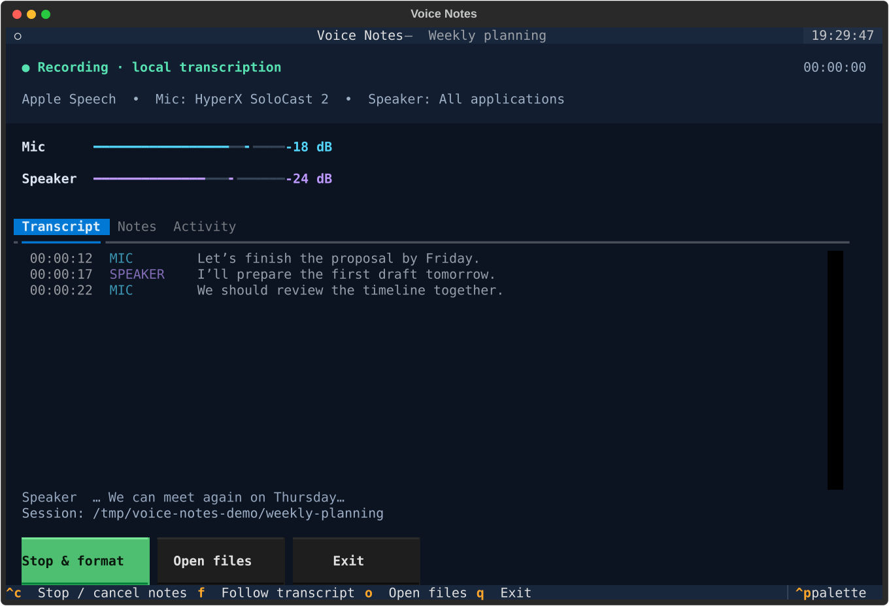

# Voice Notes CLI

Record microphone and system audio, transcribe locally, and turn the transcript into Markdown notes with **Claude Agent SDK + `claude-haiku-5-5`**. Works with any meeting app or browser; no Zoom integration or audio routing driver is required.

- Textual dashboard with colored meters, scrolling transcripts, notes preview, and keyboard controls.
- Separate microphone and system tracks, with timestamps and live audio meters.
- Apple SpeechAnalyzer by default; optional Moonshine recognition and anonymous speaker labels.
- Local transcript journal that survives capture and formatting failures.
- Optional Claude summaries, discussion, decisions, action items, and open questions.



*Dashboard preview uses synthetic meeting text.*

## Requirements

An **Apple Silicon Mac running macOS 26 or later**, Python **3.12+**, and Xcode or Command Line Tools with the **macOS 26 SDK**. Use `xcode-select --install` if Command Line Tools are missing. [uv](https://docs.astral.sh/uv/getting-started/installation/) manages Python dependencies.

First-time speech recognition can download language assets. Moonshine downloads its own models. Claude formatting requires working credentials and network access; transcription does not require Claude credentials.

## Quick start

```sh
git clone https://github.com/patnaikd/voice-notes-cli.git
cd voice-notes-cli
uv sync
uv run voice-notes build
uv run voice-notes doctor
uv run voice-notes devices

# Start with local transcription only
uv run voice-notes record --title "Weekly planning" --no-refine
```

Grant **Microphone** and **Screen & System Audio Recording** permissions to the terminal/helper when prompted. After changing permissions, quit and reopen the launching terminal or app. Use headphones to reduce remote voices being captured again by the microphone.

Interactive terminals open the **Textual dashboard** automatically. It shows the selected microphone, capture scope, elapsed time, colored audio meters, and Transcript / Notes / Activity tabs. Non-interactive terminals keep plain output.

Speak and play meeting audio. In plain mode the meters look like:

```text
Mic [#######.....]  -25 dB | Speaker [#########...]  -15 dB
```

In the dashboard, press **Space** or click **Stop & save / Stop & format**. **Ctrl-C** stops recording; during formatting it cancels notes while preserving the transcript and completed checkpoints. **Q** safely exits, skipping or canceling formatting when necessary. **F** toggles transcript following, and **O** opens the session folder. The dashboard stays open after completion so you can read the notes or inspect errors.

In plain mode, press **Ctrl-C once** to stop capture and save `transcript.md`. Finalized text is journaled during recording; `transcript.md` is rendered when capture stops. Plain mode prints only finalized sentences unless `--partials` is set. The dashboard always shows tentative speech in a compact updating area.

Force either interface when needed:

```sh
uv run voice-notes record --ui textual --title "Planning"
uv run voice-notes record --ui plain --title "Planning"
```

## Enable formatted notes

Copy the template and add your own [Claude Console API key](https://platform.claude.com/) to `.env`:

```sh
cp .env.example .env
# Edit .env: ANTHROPIC_API_KEY=your-key
uv run voice-notes record --title "Weekly planning"
```

The CLI loads `.env` **from the directory where you run it**, without overriding existing shell environment variables. `.env`, local recordings, and caches are ignored by Git. The default model is `claude-haiku-5-5`; `--model` selects another model available to your account.

On stopping, the app sends the saved transcript text to Claude and writes `notes.md`. It checks authentication before SDK startup, isolates formatting in a worker process, and gives each part a 180-second deadline. Provider errors are shown instead of a blank failure message. API usage is billed by your provider.

## Choose sources and devices

```sh
# Select a listed microphone by name or UID
uv run voice-notes record --mic "HyperX SoloCast 2" --title "Planning"

# Microphone only; no screen recording permission needed
uv run voice-notes record --source mic --duration 60 --no-refine

# System audio only
uv run voice-notes record --source system --no-refine

# Optional application filter; default is all system audio
uv run voice-notes record --app com.apple.Safari

# Allow extra time for first-time permission prompts/model installation
uv run voice-notes record --startup-timeout 300
```

The CLI microphone selection is independent of the meeting app's selection. Names match case-insensitively; use the device UID if names are ambiguous. Startup prints the selected microphone and capture scope. The displayed output device is macOS's default routing device; apps may use a different output.

All system audio includes other tabs, apps, and notifications. App filtering depends on macOS audio attribution. A browser filter captures every audible tab in that browser.

## Moonshine and speaker labels

```sh
uv sync --extra moonshine
uv run voice-notes record --engine moonshine --no-refine
uv run voice-notes record --engine moonshine --speakers --title "Design review"
```

Models are cached under `.cache/moonshine`. `--speakers` enables experimental diarization on the system-audio track only. Labels are anonymous IDs, may be revised later, and are not participant names. Apple recognition does not provide speaker identification in this app. Check the selected Moonshine model's upstream license before distributing its weights.

## Saved files and recovery

Each recording creates a directory under `meetings/`:

| File | Contents |
| --- | --- |
| `meeting.json` | Title, start time, selected engine, sources, and model |
| `events.jsonl` | Durable finalized speech, speaker revisions, statuses, and capture statistics |
| `transcript.md` | Latest finalized text, ordered by audio timestamp |
| `notes.md` | Completed Claude notes |
| `notes-part-001.md` and `.json` | Formatting checkpoint and content fingerprints |

If capture fails, saved speech is rendered before the error is reported. A crash can leave a truncated final journal line; recovery reads the earlier complete events. Empty recordings cannot be formatted.

Retry formatting without recording again:

```sh
uv run voice-notes refine meetings/YYYY-MM-DD_HH-MM-SS/events.jsonl
```

Completed parts are reused only when their text, model, formatting prompt, and saved-note fingerprint match. Changing the input or model regenerates affected parts. Delete a part's `.json` checkpoint to deliberately regenerate it. Long meetings retain separate formatted parts rather than compressing them into one potentially lossy summary.

## Privacy and limits

Audio is streamed in memory and **is not saved**. Local transcription uses public macOS APIs or Moonshine. Default formatting sends **transcript text** to Anthropic; `--no-refine` skips that request. Claude gets no tools, project settings, or project working directory. A minimal ScreenCaptureKit screen stream is discarded immediately; screen images are not saved or analyzed.

The app starts and stops manually. It has no automatic meeting detection, participant-name lookup, or acoustic echo cancellation. Transcription and summaries can be wrong; retain the raw transcript as the reference. Speak clearly and verify decisions, names, numbers, and action ownership before sharing notes.

## Development and documentation

```sh
uv sync --all-extras
uv run pytest
uv run voice-notes build
uv build
```

Tests exercise recovery, partial checkpoints, malformed events, capture startup deadlines, worker cleanup, native microphone conversion, and headless Textual stop/save, cancellation, resizing, and error display. GitHub Actions runs tests and package builds on Linux; native conversion is also tested locally on macOS. Live microphone/system transcription and an authenticated `claude-haiku-5-5` formatting request were verified on macOS 26. No accuracy or speaker-identification benchmark has been performed.

- [Troubleshooting](docs/troubleshooting.md): permissions, silence, authentication, and stalled environments.
- [Architecture](docs/architecture.md): capture, event protocol, persistence, and shutdown.
- [Research](docs/research.md): Apple models, Moonshine, and implementation decisions with sources.
