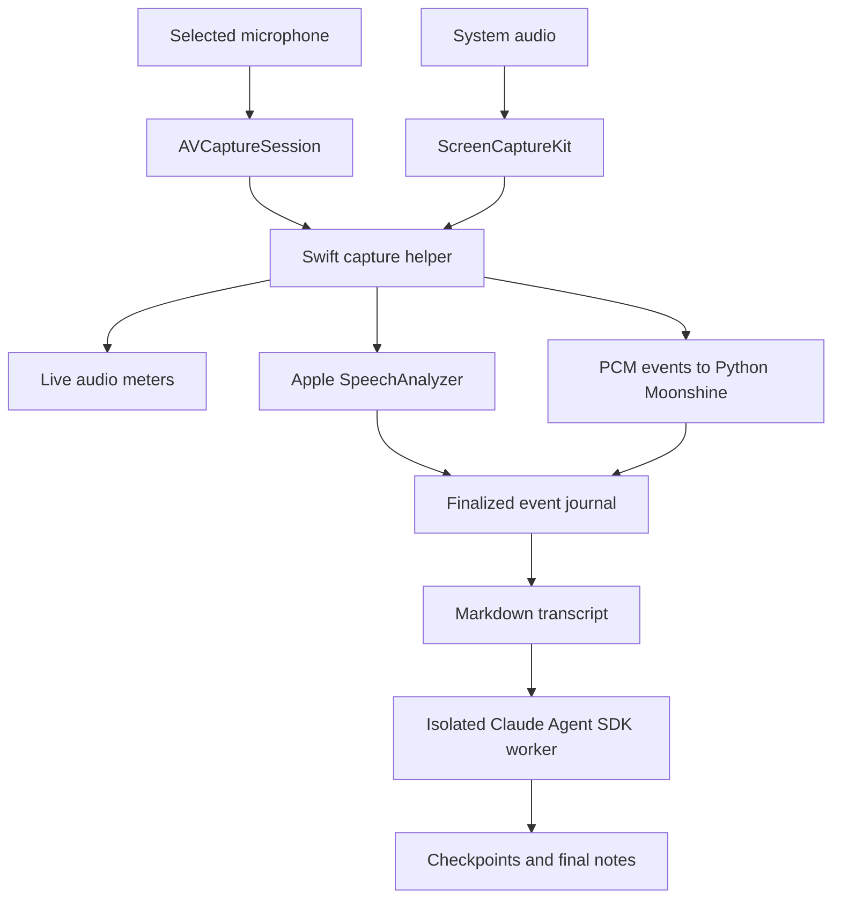
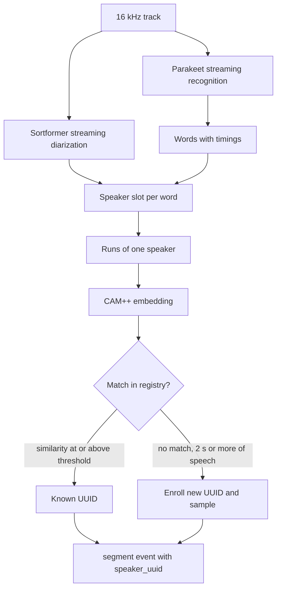

# Architecture

`voice-notes record` is a plain terminal recorder; `voice-notes serve` runs a FastAPI server with a React browser interface for all-day recording (see [web-design.md](web-design.md) for its protocol). Python controls the session and formatting. A bundled Swift executable owns macOS audio capture and Apple recognition. The CLI compiles it on demand and caches it in `.build`.

## Modules

| Module | Role |
| --- | --- |
| `cli.py` | Argument parsing, `.env` loading, terminal recording, startup deadline, signals, and session files |
| `capture.py` | Helper arguments, event parsing/validation, and device listing shared by `record` and `serve` |
| `web/app.py` | FastAPI routes, `/ws` push channel, startup recovery, meeting merge/split, `serve` |
| `web/recorder.py` | Wall-clock segment boundaries, routing helper events into segments, journals, live buffers |
| `web/supervisor.py` | Helper process lifecycle: startup deadline, stall watchdog, restart backoff |
| `web/jobs.py` | Persisted LLM queue: continuation checks and meeting notes via the isolated worker |
| `web/store.py` | `index.json`, `state.json`, `jobs.json`; segment/meeting model; transcript rendering |
| `web/hub.py`, `web/health.py`, `web/service.py` | Bounded WebSocket fan-out; memory/lag/disk monitoring; launchd agent |
| `native.py` | macOS/SDK checks, `swift build` with Info.plist embedding, signing, atomic helper replacement |
| `native/Package.swift` | SwiftPM package pinning FluidAudio (exact version) |
| `native/Sources/voice-notes-capture/Capture.swift` | Device selection, independent audio tracks, conversion, levels, Apple recognition, and file input |
| `native/Sources/voice-notes-capture/FluidEngine.swift` | Per-track streaming recognition, diarization, and speaker matching for `--engine fluid` |
| `native/Sources/voice-notes-capture/SpeakerRegistry.swift` | Speaker store: embeddings, UUIDs, 60 s samples, atomic writes |
| `speakers.py` | Registry reads, naming, merging, deleting, and retroactive transcript re-rendering |
| `moonshine.py` | Optional streaming recognizers, timestamp gaps, and speaker-label revisions |
| `meter.py` | Terminal redraw thread and RMS/peak display |
| `session.py` | Journal validation, latest-segment selection, Markdown rendering, atomic writes |
| `refine.py` | Authentication checks, chunking, worker deadline, verified checkpoint reuse |
| `refine_worker.py` | SDK import and one tool-free Claude request per worker |
| `packaging/_voice_notes_launcher.py` | Console entry point and hidden `.pth` editable-install recovery |

## Web server

One asyncio event loop runs everything. The supervisor reads helper stdout with an asyncio subprocess and hands each event to the recorder. The helper runs continuously; Python rolls segments at wall-clock boundaries and routes each finalized line to the segment containing its wall-clock start (`ready` time + helper seconds), keeping the previous segment open for a short grace period for late finals. Line ids become `r{run}-{id}` so they stay unique across helper restarts. Levels and partials are coalesced (10/s and 5/s) and never journaled. Closing a segment renders its transcript and enqueues LLM jobs; Claude calls reuse the isolated worker process, so the loop never blocks on the SDK. Each WebSocket client has a bounded queue that drops levels and partials first. See [web-design.md](web-design.md) for the full contract.

## Events and timelines

The helper emits one JSON object per stdout line. Its writes are serialized. `ready`, `status`, `error`, `level`, `partial`, `segment`, and `capture_stats` describe the session. Moonshine mode also emits base64 float32 `audio` events at 16 kHz mono; those samples stay in memory and are not journaled.

A finalized segment contains a source (`mic` or `system`), stable string ID, start/end seconds, and text. Speaker spans are optional. Segment events are validated before journaling. Later events with the same source and ID replace earlier versions when rendering; this supports speaker revisions without duplicate transcript lines.

Each source retains a shared presentation-time origin. Apple conversion ensures resampled buffers do not overlap. Moonshine fills timestamp gaps with bounded silence chunks and drops overlapping samples. RMS and peak levels are emitted approximately every 100 ms; meters display incoming sound independently of recognition.

## Persistence and shutdown

Finalized events are flushed and fsynced. Markdown and metadata writes use unique temporary files, fsync, and atomic replacement, protecting an existing file if replacement fails. Recovery tolerates one truncated final journal line and rejects corruption earlier in the journal.

Ctrl-C asks capture to finalize. A 20-second grace timer kills a helper that will not stop. The startup deadline covers the interval before `ready`; `--duration` counts only active recording time. Finalized speech is rendered even after capture failures. Power loss or an uncatchable process termination can still require journal recovery.

## Fluid engine and speaker identity

Each track owns its models and a worker task fed by an ordered queue; gaps are zero-filled so word times equal meeting time. Recognition emits sub-word tokens in batches that can end mid-word, so words are assembled only once the next word starts. The decoder stretches a word to the next word's start, so attribution and embeddings use at most 0.6 s per word. An utterance closes at a pause or sentence end once diarization has caught up with it, and is split wherever the diarizer's speaker slot changes. A run of at least 1.2 s is embedded and matched; shorter runs inherit the slot's last speaker. Matches of 0.75 or more refine the stored centroid. A run of 2 s or more that matches nothing enrolls a speaker, unless its similarity is within 0.10 of the threshold and the slot already has a speaker.

The registry is one directory per UUID (`speaker.json`, `sample.wav`). Swift writes embeddings and samples and preserves any name already in `speaker.json`; Python writes names and merge tombstones. Journals store UUIDs only, so a rename or merge changes how every past transcript renders without touching the journals.

## Formatting

The SDK receives transcript text in bounded parts and runs in an empty temporary working directory with tools disabled, empty settings sources, and strict MCP configuration. A separate process lets the parent enforce a deadline even when Python imports block. Timeout/cancellation kills the worker process group.

Each completed part has Markdown plus a manifest containing hashes of the input/model/prompt and generated notes. Reuse requires both hashes to match. These manifests contain no transcript or API key. Final notes are replaced only after all parts succeed. Retries can therefore retain completed work while safely regenerating changed or corrupted parts.

The model can still invent or misinterpret facts despite the conservative prompt. This app does not treat a formatted summary as verified meeting truth.
