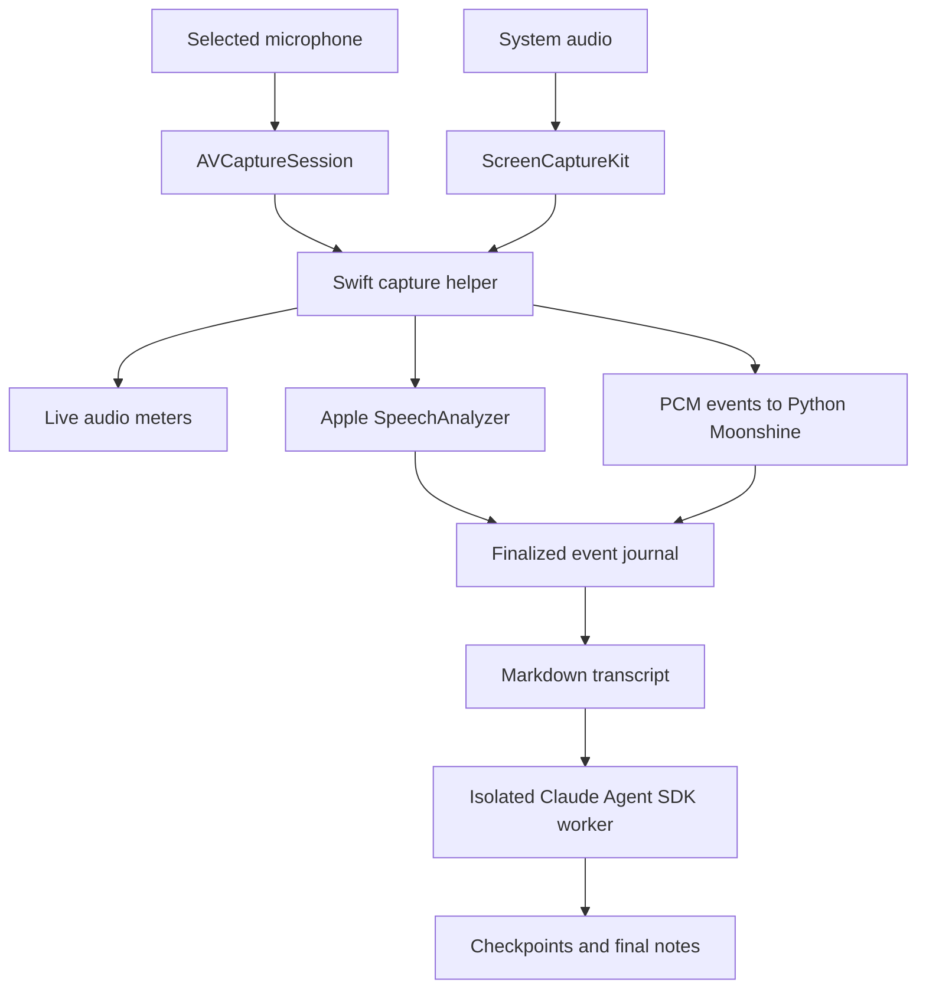

# Architecture

Textual provides the interactive recording dashboard; plain output remains available for pipes and scripts. Python controls the session and formatting. A bundled Swift executable owns macOS audio capture and Apple recognition. The CLI compiles it on demand and caches it in `.build`.

## Modules

| Module | Role |
| --- | --- |
| `cli.py` | Argument parsing, `.env` loading, UI selection, capture subprocess, startup deadline, signals, and session files |
| `tui.py` | Textual dashboard, live meters, transcript revisions, notes preview, and keyboard controls |
| `control.py` | Thread-safe cooperative stop/quit and formatting cancellation |
| `native.py` | macOS/SDK checks, bounded compilation/signing, atomic helper replacement |
| `native/Capture.swift` | Device selection, independent audio tracks, conversion, levels, and Apple recognition |
| `moonshine.py` | Optional streaming recognizers, timestamp gaps, and speaker-label revisions |
| `meter.py` | Terminal redraw thread and RMS/peak display |
| `session.py` | Journal validation, latest-segment selection, Markdown rendering, atomic writes |
| `refine.py` | Authentication checks, chunking, worker deadline, verified checkpoint reuse |
| `refine_worker.py` | SDK import and one tool-free Claude request per worker |
| `packaging/_voice_notes_launcher.py` | Console entry point and hidden `.pth` editable-install recovery |

## UI and backend boundary

The dashboard runs the existing recording backend in a Textual thread worker. Observer events are posted as Textual messages; widgets are updated on the UI thread. Audio payloads stay in the recognizer and are never forwarded to the dashboard. High-rate levels and partial speech update existing widgets, while finalized text appears in the scrolling transcript. The visible transcript retains a bounded recent history; the journal retains the complete session.

The same backend supports both interfaces. Plain-mode signal handlers run on the main thread. Dashboard controls use `SessionControl` callbacks instead, with pending stop requests honored after startup. Formatting cancellation is scheduled on its worker's asyncio loop and cleans up the isolated SDK process. Exit waits for finalization and saving rather than abandoning the capture process. The dashboard wrapper routes SIGINT to Stop and SIGTERM/SIGHUP to safe exit, restoring prior signal handlers when it closes.

## Events and timelines

The helper emits one JSON object per stdout line. Its writes are serialized. `ready`, `status`, `error`, `level`, `partial`, `segment`, and `capture_stats` describe the session. Moonshine mode also emits base64 float32 `audio` events at 16 kHz mono; those samples stay in memory and are not journaled.

A finalized segment contains a source (`mic` or `system`), stable string ID, start/end seconds, and text. Speaker spans are optional. Segment events are validated before journaling. Later events with the same source and ID replace earlier versions when rendering; this supports speaker revisions without duplicate transcript lines.

Each source retains a shared presentation-time origin. Apple conversion ensures resampled buffers do not overlap. Moonshine fills timestamp gaps with bounded silence chunks and drops overlapping samples. RMS and peak levels are emitted approximately every 100 ms; meters display incoming sound independently of recognition.

## Persistence and shutdown

Finalized events are flushed and fsynced. Markdown and metadata writes use unique temporary files, fsync, and atomic replacement, protecting an existing file if replacement fails. Recovery tolerates one truncated final journal line and rejects corruption earlier in the journal.

Ctrl-C asks capture to finalize. A 20-second grace timer kills a helper that will not stop. The startup deadline covers the interval before `ready`; `--duration` counts only active recording time. Finalized speech is rendered even after capture failures. Power loss or an uncatchable process termination can still require journal recovery.

## Formatting

The SDK receives transcript text in bounded parts and runs in an empty temporary working directory with tools disabled, empty settings sources, and strict MCP configuration. A separate process lets the parent enforce a deadline even when Python imports block. Timeout/cancellation kills the worker process group.

Each completed part has Markdown plus a manifest containing hashes of the input/model/prompt and generated notes. Reuse requires both hashes to match. These manifests contain no transcript or API key. Final notes are replaced only after all parts succeed. Retries can therefore retain completed work while safely regenerating changed or corrupted parts.

The model can still invent or misinterpret facts despite the conservative prompt. This app does not treat a formatted summary as verified meeting truth.
